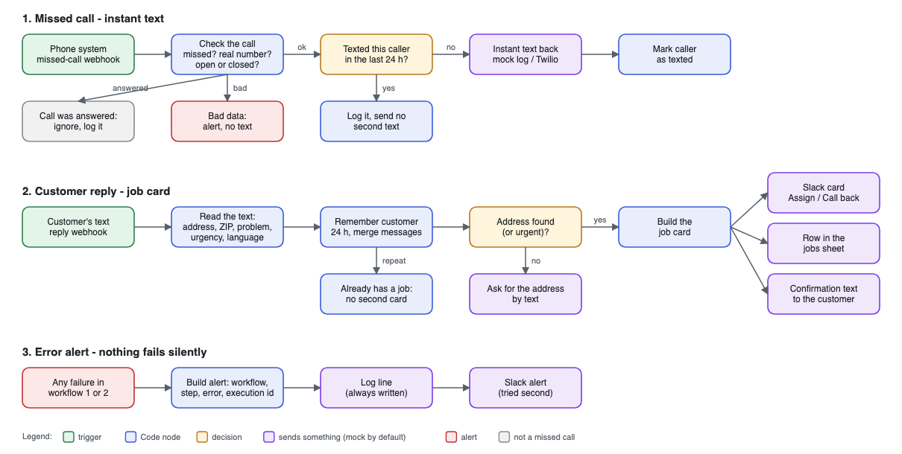

# Missed call → instant text → job card (n8n demo for home-service companies)

**Tested on made-up calls and messages; not yet run on a live phone number.**
It has run in a real local n8n 2.44.7 on made-up data: 20 of 20 scenarios passed (see [How it was tested](#how-it-was-tested)). No paid AI is used: plain rules only.

"Summit Home Services" is an invented HVAC / plumbing / electrical / garage-door company. This demo shows how I would stop it losing jobs to missed calls.

## What it does for the business owner
1. **A customer calls and nobody picks up.** Within seconds they get a text: *"Sorry we missed your call. Reply with your address and the problem, and a technician will call you back."* After hours the text says the office is closed, promises a call in the morning and says to dial 911 in an emergency.
2. **The customer replies.** The workflow reads the address, ZIP and problem (no heat, no cool, leak, garage door, electrical, other) in English or Spanish, and marks the job **URGENT** for a gas smell, carbon monoxide, flooding, smoke or fire, and no heat in winter. Urgent customers also get safety words in the reply ("leave the building and call 911").
3. **A job card appears in Slack** with **Assign** and **Call back** buttons, and **a row is added to the jobs sheet**. The customer gets a confirmation text with the job number. If the address is missing, they are asked for it first (unless the job is urgent: then the card goes out at once).
4. **Nobody gets texted twice.** The same caller within 24 hours is not texted again, and the same customer does not get a second job card.
5. **Nothing fails silently.** If anything breaks (the text sender is down, Slack is down, bad data), an alert with the execution id goes to Slack and to a log line. The log line is written first, so the alert exists even when Slack is the thing that is down.

## What is in the box
| Path | What it is |
|---|---|
| `workflows/1-missed-call.json` | Missed call → instant text (17 nodes) |
| `workflows/2-customer-reply.json` | Customer reply → job card, Slack, jobs sheet, confirmation text (19 nodes) |
| `workflows/3-error-alert.json` | Error workflow: Slack alert + log line with the execution id (6 nodes) |
| `code/*.js` | The JavaScript of every Code node, as readable files |
| `tools/build.mjs` | Builds the three workflow files from `code/` |
| `tools/mini-runner.mjs` | Small offline engine that runs the workflow files without n8n |
| `tools/validate-nodes.mjs` | Checks the workflow files against an installed n8n's node definitions |
| `tests/` | Mock server, 20 scenarios, the runner, `live-n8n.sh` (starts a throwaway local n8n). Results: [TESTS.md](TESTS.md) (offline), [TESTS-LIVE.md](TESTS-LIVE.md) (real n8n) |

## Mock by default, real by switch
Nothing here talks to a real account.
- **Sender:** "Send SMS (mock)" posts to a local mock that writes a log file. "Send SMS (Twilio)" is in the workflow but **turned off and has no credentials**. To go live: add the client's Twilio credential, turn it on, set `smsMode` to `twilio` in the Config node.
- **Slack:** the card is posted to `slackWebhookUrl` (default: the local mock). Put the client's Slack incoming-webhook URL there.
- **Jobs sheet:** "Add Row (mock CSV)" writes `jobs.csv`. "Add Row (Google Sheets)" has the same 11 columns, is **turned off** and has no credentials.

## Settings (the `Config` node, one place per workflow)
| Field | Demo value | Meaning |
|---|---|---|
| `businessName` | Summit Home Services | Start of every text |
| `businessTimezone`, `openHour`, `closeHour` | America/Chicago, 7, 19 | Used when the phone system sends no open/closed flag (Mon-Sat) |
| `dedupeHours` | 24 | Repeat-caller / repeat-customer window |
| `winterMonths` | 11,12,1,2,3 | "No heat" is urgent in these months |
| `smsMode` | mock | `mock` or `twilio` |
| `allowTestClock` | false | Tests only: when true, a `TestNow` field in the webhook body is used as the current time. Leave it false in production |
| `mockBaseUrl`, `slackWebhookUrl` | http://127.0.0.1:8099 ... | Where the mock services listen |

## The rules (plain, no AI)
- **Problem type:** first match wins, in this order: no heat, no cool, garage door, electrical, leak (plumbing words count as leak), other. Other types mentioned are noted. Spanish keywords are included.
- **Address:** house number + street name + a street word (St, Ave, Rd, Dr, Ln ...), optional unit. City, state and ZIP are read when they follow ("Dallas TX 75201"). A gas smell is flagged urgent and is **not** filed as a "leak".
- **Limits:** this reads ordinary US street addresses. PO boxes, "the blue house on the corner" and very unusual formats go to the "ask for the address" path or the card without an address. Real customer texts will teach new keywords; the lists sit at the top of `code/parse-reply.js`.

## How it was tested
- 20 made-up scenarios, 78 checks, all passing: normal missed call, no reply, repeat calls, after hours, invalid phone, answered call, gas smell, missing address, Spanish, sender failure, Slack failure and more. Table and every check: [TESTS.md](TESTS.md). Run it yourself: `python3 tests/run_tests.py` (Python 3.9+ and Node 20+, nothing to install).
- **Run in a real n8n:** the same 20 scenarios were sent to the production webhooks of a local n8n 2.44.7 (127.0.0.1 only, its own empty data folder, no credentials, mock sender, Slack and sheet): **20 of 20 passed, 78 of 78 checks**. Table and every check: [TESTS-LIVE.md](TESTS-LIVE.md). Repeat it: `bash tests/live-n8n.sh up`, then `python3 tests/run_tests.py --live --n8n-db tests/out/n8n-live/.n8n/database.sqlite`, then `bash tests/live-n8n.sh down` (the script starts a throwaway n8n and never touches another n8n's data). The imported copies differ from `workflows/*.json` in one value only: `Config.allowTestClock` is `true`, so a scenario can send a pretend clock.
- **What the real n8n showed that the offline engine could not:** n8n 2.x only calls an error workflow that is **published**. Left unpublished, it logs "Workflow ... is not active and cannot be executed" and no alert is sent. Publish `3-error-alert.json` like the other two (see Import below).
- **Offline engine:** `python3 tests/run_tests.py` runs the same scenarios without n8n through `tools/mini-runner.mjs`, a small engine that executes the workflow files against the mock server (20 of 20 too, [TESTS.md](TESTS.md)). It is not n8n.
- **Checked against n8n 2.44.7:** `node tools/validate-nodes.mjs <n8n folder>` confirmed that every node type, version and parameter name in the files exists in that n8n (static check).
- Everything used fictional 555-01xx numbers and invented addresses.

## What a real client needs (all in the client's own name)
1. **Twilio account and a US phone number.** US business texting needs registration with the carriers (A2P 10DLC): approval takes time and has fees. Twilio's own price page: <https://www.twilio.com/en-us/sms/pricing/usa>. Prices change, check before quoting.
2. **Slack workspace** with an incoming webhook for the dispatch channel. (Making the Assign and Call back buttons *do* something needs a Slack app with interactivity and one more small workflow. The buttons show on the card; the click handler is not part of this demo.)
3. **Google account and a Google Sheet** for the jobs sheet.
4. **n8n** that stays on: a small server (self-hosted) or n8n Cloud.

Running costs are paid by the client directly to Twilio and n8n (a few dollars a month for a number plus a cent or so per text and carrier fees, plus the n8n server or subscription). Slack and Google Sheets are usually free for this size. These are rough orders of magnitude, not a quote.

**Hooking up Twilio (to be confirmed on the first live number):** the number's voice flow forwards the call to the office with `<Dial action="https://<n8n>/webhook/hsd/missed-call">`; Twilio then posts `DialCallStatus` (read first) or `CallStatus` (`no-answer`, `busy`, `canceled` count as missed). The text-message webhook points at `/webhook/hsd/customer-reply`. The optional `BusinessHours` field is not sent by Twilio; without it the Config hours are used.

**Import:** import file 3 first, then 1 and 2. If n8n changed the ids, open Settings of workflows 1 and 2 and pick "HSD 3 - Error alert" as the error workflow. **Publish all three, the error workflow too** (n8n 2.x does not call an unpublished error workflow; the real-n8n test found this).

## Known limits (honest list)
- The 24-hour memory uses n8n's built-in workflow memory. It only persists while the workflow is **active** (not in editor test runs), is lost if the workflow is re-imported, and does not suit several n8n instances. Two near-simultaneous texts from one number can both get through. For real traffic keep the memory in a database or a sheet.
- The webhooks are not signature-checked. A live setup should verify Twilio's signature (or use a secret path) before going public.
- The safety wording in the texts (gas, carbon monoxide, flooding, fire) is general advice. The client should read and approve it.
- STOP and HELP replies are handled by Twilio by default; that was not tested here.
- Texts with accents (the Spanish ones) are sent as Unicode SMS, which costs more segments.
- In a real n8n the error text of a failed step is worded by n8n; the alert shows whatever it reports.
